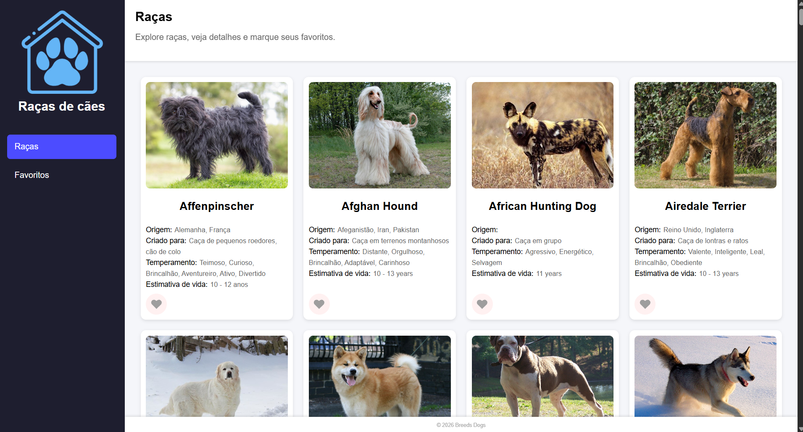
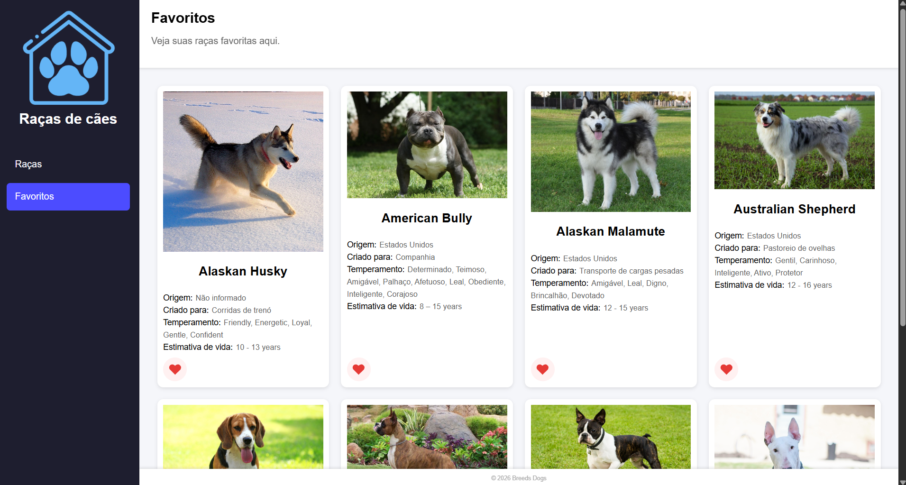

# Raças de cães (Frontend)

> Objetivo da apicação é visualizar informações de raças de cães como foto, nome da raça, temperamento, estimativa de vida e origem.

<p align="left">
   &nbsp;&nbsp;
   
</p>

## Tecnologia usadas
HTML, CSS e JS

## 🚀 Rodar projeto frontend

Abrir o terminal no diretório "breeds-dogs-frontend"

Rode o arquivo abaixo no Powershell
```
./index.html
```
ou clique duas vezes no arquivo index.html que esta dentro do diretório "breeds-dogs-frontend"

Após executado um dos dois irá abrir a pagina inicial no seu navegador.


## 🤝 Alunos

Aluno que contribuíram para este projeto:

<table>
  <tr>
    <td align="center">
      <a href="https://github.com/fabianoandrad" title="Fabiano Andrade">
        <br>
        <sub>
          <b>Fabiano Andrade</b>
        </sub>
      </a>
    </td>
    <td align="center">
      <a href="https://github.com/RaylaAmbrosio" title="Rayla Ambrosio">
        <br>
        <sub>
          <b>Rayla Ambrosio</b>
        </sub>
      </a>
    </td>
    <td align="center">
      <a href="https://github.com/danielasalesdev" title="Daniela">
        <br>
        <sub>
          <b>Daniela</b>
        </sub>
      </a>
    </td>
  </tr>
</table>
